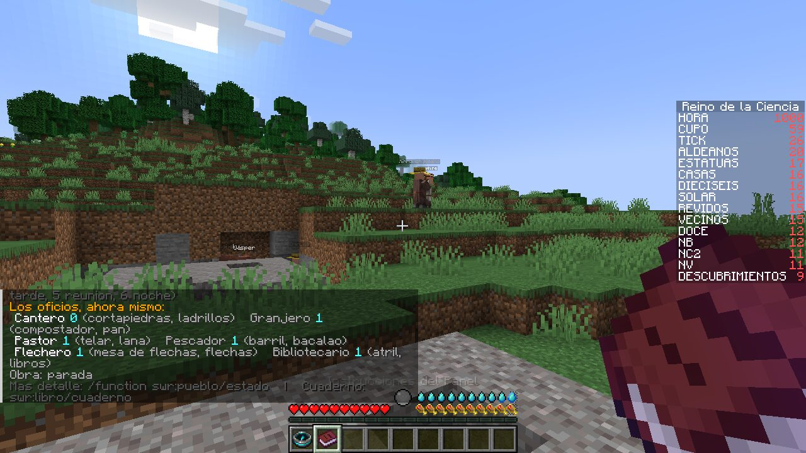

# Stone World Reborn

**A Dr. Stone survival world for Minecraft 1.21.1 + NeoForge.** Petrifiy people, revive them, and let the villages grow on their own while you are away. *(Docs are in Spanish: the project started as a two-player world in Spain.)*

Un mundo de **Dr. Stone** para Minecraft **1.21.1 + NeoForge**, pensado para jugar de dos en dos: petrificas, revives gente, y los pueblos crecen solos mientras tu estas fuera. Con eras cerradas, aldeas rivales, un mapa de isla diseñado a mano y un panel para llevar las cuentas del reino.



> De los mods, aqui solo esta el codigo de los **tres propios** (`optics-mod`, `crank-dynamo`, `pharmacy-mod`). Los ~35 de terceros son de sus autores y varios son ARR: se **enlazan, no se redistribuyen**, y el instalador solo baja los que estan en Modrinth.

## Empezar

Tres caminos, elige uno:

| Si eres… | Camino |
|---|---|
| **Pereza maxima** y tienes un agente de terminal | [`IA.md`](IA.md): pega un prompt y el agente instala y comprueba |
| **Segundo jugador** | [`GUIA_TLAUNCHER.md`](GUIA_TLAUNCHER.md), paso a paso desde cero (leo antes el aviso sobre TLauncher) |
| **Anfitrion** o quieres montarlo tu | [`LEEME.md`](LEEME.md) + [`DESCARGAS.md`](DESCARGAS.md) |

A que se juega y como se completa, paso a paso: [`REGLAS.md`](REGLAS.md).

> **Sobre los launchers.** La via recomendada es el launcher oficial de Minecraft con una instalacion aparte de NeoForge, o **Prism / MultiMC**, que permiten un perfil por juego sin tocar el `.minecraft` de siempre. `GUIA_TLAUNCHER.md` existe porque mucha gente ya tiene TLauncher instalado y el pack se probo ahi, pero ese programa se asocia a cuentas no premium y a instaladores con adware: no es lo que este proyecto recomienda. Ver el aviso al principio de esa guia.

Arranque en corto:

```bash
# 1. Java 21 y NeoForge 21.1.262 sobre Minecraft 1.21.1 (perfil aparte del de siempre)
# 2. mods en la carpeta del perfil, no en la global:
#    ~/.minecraft/versions/<perfil>/mods  (launchers con perfiles);  .minecraft/mods en el oficial
node herramientas/instalar.mjs --download --mc-dir "RUTA_AL_PERFIL"   # baja los de Modrinth, lista los de CurseForge
node herramientas/instalar.mjs --check    --mc-dir "RUTA_AL_PERFIL"   # debe decir 0 faltan
# 3. panel-del-reino.zip a saves/<mundo>/datapacks/
# 4. dentro del juego: /function swr:panel/informe   y el libro: /function swr:panel/libro
```

## Que hay

```
LEEME.md             el pack: decisiones, por que estos mods, como se juega
REGLAS.md            reglas, el bucle y el recorrido completo, era por era
IA.md                instalacion delegada a un agente + prompt para pegar
GUIA_TLAUNCHER.md    segundo jugador y launcher, desde cero (con aviso: TLauncher no es la via recomendada)
SEGUNDO_JUGADOR.md   segundo jugador con CurseForge App
DESCARGAS.md         mods con enlace y version (los de CurseForge, a mano)
ERAS.md              la serie era por era y su traduccion a Minecraft
SERIE.md             estudio de la serie: arcos, personajes y ciencia, de arriba abajo
GUIA_INMERSION.md    paso a paso para jugar dentro de la serie (equipo, ajustes, eras)
pack-inmersion/      pack de recursos: 11 texturas de cuadro (8 redibujadas que sustituyen a las
                     vanilla, mas Perseus, medusa y destello), textos del menu y
                     ReinoDeLaCiencia.zip, el pack empaquetado, listo para resourcepacks/
quests/              arbol de misiones FTB Quests: 5 eras, 34 misiones
ISLA.md              diseño de la isla: 8 zonas y orden de construccion
isla.json            las mismas coordenadas en formato maquina
mapa-isla.png        plano cenital generado desde isla.json
mods.txt             lista de mods, fuente y version
panel/               datapack: eras, ciudadanos, aldeas, viajes, el pueblo y el libro de la serie
panel-del-reino.zip  el datapack listo para saves/<mundo>/datapacks/ (lo genera `./comprobar_todo.sh`)
herramientas/        instalar.mjs, generadores del plano y del pack, arnes de servidor (rcon.py, probar_servidor.py)
optics-mod/          mod de optica: lentes, telescopio, banco de pulido, gafas de Kinro
crank-dynamo/        mod de energia: dinamo de manivela, 8 FE/tick
pharmacy-mod/        mod de farmacia: sulfamida y jeringa
suika-mod/           mod del casco de sandia de Suika (armadura de casco)
musica-mod/          sonido de Lilian y su disco, registrados para el tocadiscos
CAMPO.md             el campo del pueblo: parcelas, rotacion y rendimiento
EPISODIOS.md         que pasa en cada episodio: las cuatro temporadas y los dos especiales
FALTAN.md            lo que sale en la serie y no esta en el juego, por factibilidad
validador/           comprobador del datapack (estructura, JSON, mcfunctions, referencias)
tests/               pruebas del validador y del datapack (pytest, 259 casos)
comprobar_todo.sh    pytest + validador + regenerar el zip, de una vez
pyproject.toml       metadatos del validador y config de pytest
LICENSE              MIT para el codigo; LICENSE-CONTENIDO.md, CC BY 4.0 para textos y arte
NOTICE               proyecto fan: que es de quien y que no se distribuye
CONTRIBUTING.md      como comprobar, que se acepta y bajo que licencia entra tu aportacion
docs/capturas/       capturas del juego
```

## El bucle

Petrificar → revivir aldeanos → cada uno da un oficio → la colonia crece sola → el crecimiento paga la siguiente era → las aldeas rivales reaccionan.

- **El bar del Perseus** (23/11/2026): en la cubierta del barco se monta un salon con barra, dos mesas de poker y una mesa de bolos, con Francois detras de la barra. La despensa no inventa comida: la llenan el granjero y el pescador del pueblo una vez al dia y lo que entrega el jugador (8 unidades de cada ingrediente, tope 64). La carta se pide por chat y cada plato cobra su stock antes de servir. El bar viaja ya dentro del `perseus.nbt` (814 bloques solidos, barra y una mesa de poker incluidas); la mesa de bolos se monta aparte porque pide 12 bloques de largo para 7 de manga. Y hay un **arnes de servidor** (`herramientas/probar_servidor.py`): arranca el mundo de pruebas, espera a RCON y comprueba sin jugador que el pack carga, que `CIEN` vale 100, que un poker de reyes suma 813, que `bolos/montar` deja diez bolos y que `swr:bar/estado` responde. Lanzado contra el mundo de pruebas el 23/11/2026: 6/6. El poker es una baraja de 52 cartas repartida con `/random`, con los nueve tipos de mano y bote de 10 fichas; los bolos son diez armor stands y una bola que rueda 16 pasos. `tests/test_bar.py` (104 casos) lo vigila. Detalle en `BAR.md`.

## Estado, sin adornos

- Datapack, plano y coordenadas **verificados**: JSON valido, zip correcto, 8/8 zonas, 20 funciones, distancias minimas de MineColonies respetadas.
- `herramientas/instalar.mjs` **probado de verdad**: resuelve versiones contra la API de Modrinth, descarga, comprueba la carpeta y devuelve codigo 0/1 segun falten mods o no. **Solo baja los 20 que estan en Modrinth**; de los 18 que solo viven en CurseForge saca la lista con su enlace, porque sus licencias no permiten bajarlos por detras.
- Los **tres mods propios** se compilan aqui con JDK 21 contra NeoForge 21.1.262: `./gradlew build` dentro de cada carpeta (el wrapper va incluido, no hay que instalar Gradle). Los `.jar` salen en `dist/` o `build/libs/` y **no se versionan**: se compilan.
- Los numeros de las pruebas de abajo son de su fecha. La lista del instalador ha ido creciendo (hoy **38 entradas: 20 automaticas y 18 a mano**), asi que los "34 mods" de noviembre y los "41 jars" del servidor no hay que cuadrarlos con lo que diga hoy el script.
- **Pack arrancado de verdad** (13/11/2026): servidor NeoForge 21.1.262 dedicado, Java 21, 34 jars bajados de cero por el propio instalador. `Done (2.1s)`, sin dependencias rotas, el datapack lo detecto solo (`file/panel-del-reino.zip (world)`) y `/function swr:panel/informe` se ejecuto sin error. Quedan 4 recetas de compatibilidad de Thirst que el autor no actualizo (`Parsing error ... thirst:compat/...`): no rompen el arranque, solo no cargan esas recetas.
- Lo que esos arranques destaparon, ya corregido: faltaban **6 dependencias** (BlockUI, FTB Library, FTB Teams, Architectury API, GlitchCore y MineColonyTax), faltaba **Patchouli** para el libro de War 'N Taxes, y **CC: Tweaked 1.121.0 pide NeoForge 21.1.265+**, asi que se fija la 1.120.2.
- **Cliente arrancado de verdad** (13/11/2026): vanilla 1.21.1 + NeoForge 21.1.262, 34 mods, `Setting user: Teo`, `Sound engine started` y menu principal sin ningun error propio del pack (el menu cuenta **40 mods** porque suma los integrados de NeoForge).
- **Dentro de un mundo, medido** (17/11/2026): mundo copiado a un gameDir aparte para no tocar partidas, 34 mods, Java 21 y 1280x720 con Embeddium. **Mediana 59,5 fps quieto y 63 andando**, minimos de 28-36 en los picos de carga de chunks y de colonias. Con la GPU al 19-73 %, el limite es la CPU y el servidor integrado (30-63 ms por tick), no la grafica. Metodo y cifras completas en `GUIA_INMERSION.md` §0.
- **Contenido de la serie ampliado** (17/11/2026): pestana de avances propia «Dr. Stone» con 10 hitos repartidos por los arcos, libro de **«Las cien historias»** de Ruri (12 paginas, `/function swr:serie/historias`), trofeo de la **medusa** con su avance, y el arbol de FTB Quests de 25 a **27 misiones** (las cien historias y la medusa). Sigue siendo todo datapack: no hay que recompilar nada.
- **El Perseus con formas y fisica** (17/11/2026): el barco ya no es una caja. `PERSEUS.md` trae el plano a escala 1 bloque = 1 m (30 m de eslora, 7,2 de manga, cuadernas, cubierta, palos y portillas), `PERSEUS_PERFIL.svg` el perfil y la planta, y `PERSEUS_FISICA.md` la simulacion: GM 1,45 m, GZ 0,79 m a 30 grados, borda al agua a 37 grados, 12,4 nudos de velocidad limite de casco. Se regenera con `herramientas/perseus_modelo.py` y `herramientas/simular_perseus.py`. Ademas el barco esta ya modelado bloque a bloque en la estructura `swr:perseus` (la genera `herramientas/generar_estructura_perseus.py`): en partida se coloca entera con `/place template swr:perseus <x> <y> <z>`, sin picar a mano.
- **Tripulacion del Perseus** (17/11/2026): la era 4 deja de ser un checkmark. Botadura en el puerto (`/function swr:tripulacion/botadura`), tres NPC con nombre y oficio —Ryusui navegante, Sai contable, Francois cocinero— y un zarpe que **se niega** si falta barco botado, falta uno de los tres o estan a mas de 48 bloques. Dos avances nuevos (`swr:serie/tripulacion`, `swr:serie/zarpe`), la cadena completa en una pagina propia del cuaderno y en las quests, que pasan de 30 a **33**.
- **Tramo A completo** (25/11/2026): las **29 piezas** que solo pedían datapack ya están, desde la cueva del milagro hasta el satélite Senku-1. Entran la cueva como yacimiento que se repone, el arranque desnudo con contador de días, las cuatro estatuas del prólogo con nombre, el contador del millón de revividos, la biblioteca de las cien historias, el Grand Bout, el juicio de Magma, la elección y los tres decretos, el consejo de guerra, la radio con interferencia de Stanley, el teléfono con batería, el fax que copia el mapa de verdad, la imprenta, la cámara, la ruleta y el blackjack, los denarios, el mercado, la escuela, el hospital con sulfamida, las seis rutinas que faltaban, las fotos, los carteles de calle, el cementerio de Byakuya, Superalloy City, las estatuas repartidas, la onda de 40 bloques, petrificar y revivir a un jugador con su inventario guardado, la frase diaria por radio, el valle Taurus-Littrow y los siete intentos del satélite. Todo se descubre desde `/function swr:serie/tramo_a`. `tests/test_tramo_a.py` (28 casos) vigila que el menú llegue a cada sistema, que el estado se guarde y que ninguna puerta cobre de menos. Total: **309 pruebas**, validador limpio y **9/9** en el arnés. Detalle y lo que sigue en [`FALTAN.md`](FALTAN.md).
- **Las eras, al día y con el epílogo** (22/11/2026): `ERAS.md` decía que la dinamo de manivela y las sulfamidas "faltaban" cuando llevan desde el 17/11 en el pack; ahora cuenta los tres huecos del arco de la aldea y cómo los tapan `optics-mod`, `crank-dynamo` y `pharmacy-mod`, y dónde sigue habiendo teatro. Y entra el **epílogo TERRAFORMING** —el one-shot del tomo 27, situado después del capítulo 232, que en octubre de 2026 se anunció como nueva animación—: al **cerrar la era 5** se abre una cadena de cuatro escenas (`swr:serie/terraforming/iniciar` → `naufragio`, `balsa`, `nitrico`, `silicio`), cada una con su título, su sonido y su objeto de recuerdo, y la última da el avance `swr:serie/terraforming`. `tests/test_terraforming.py` (10 casos) vigila que la cadena no se rompa, que el contador exista desde `load`, que el avance cuelgue de `why` y que ninguna escena lleve comandos destructivos. El estudio de la serie (`SERIE.md`) gana la sección 16 con el capítulo escena por escena y el veredicto de su ciencia. Total: **281 pruebas**.
- **Arnés paciente y llamadas vigiladas** (25/11/2026): el arnés mandaba `reload` en cuanto abría el puerto RCON, antes de que cargasen los 40 mods; el hilo del servidor se bloqueaba y el socket se rendía. Ahora espera a que el log diga «Done (», reintenta hasta tres veces y el cliente RCON sube su espera a 180 s. `tests/test_referencias.py` gana cuatro casos que recorren el pack real —ninguna llamada `function` puede apuntar a un archivo ausente— y vigilan que `FALTAN.md` diga las 249 funciones y las 38 fichas que hay. `pueblo/estado` y la ayuda de `load` enseñan `pueblo/casa/cancelar`. Total: **281 pruebas** y **9/9** en el arnés.
- **38 fichas, medusa activa y cuatro planos** (25/11/2026): el reparto de estatuas pasa de 12 a **38 fichas** (entran Tsukasa, Ryusui, Xeno, Stanley, Moz y compañía, sin tocar los seis puestos de oficio) y `tests/test_personajes_rutinas.py` vigila que el módulo cuadre. La medusa deja de ser un trofeo: **tres cargas, 30 segundos y 12 bloques de radio**, con `/function swr:serie/medusa/iniciar` (o el botón «¿Quieres morir?» de `/function swr:serie/medusa/voz`), `estado` y `desactivar`. El fluido milagroso se puede **llevar como frasco** y se gasta antes que el cupo del campo. Y los cuatro sitios del tramo A —isla del tesoro, Corn City, Haber-Bosch y Araxá— se **colocan enteros** con `/function swr:serie/colocar` (menú) o `serie/colocar/<sitio>`, generados por `herramientas/generar_estructuras.py` (determinista, con `--comprobar`) y probados como NBT en `tests/test_estructuras.py`. El arnés de servidor sube a **9 comprobaciones** (medusa, frasco y los cuatro planos) y todo el conjunto queda en **281 pruebas**. Detalle en [`PERSONAJES.md`](PERSONAJES.md) y [`FALTAN.md`](FALTAN.md).
- **Personajes con su aspecto y el pueblo en cuadricula** (22/11/2026): las estatuas ya no salen con el oficio que toque. Cada una recibe una **ficha fija** —aldea de Minecraft (que cambia ropa y tono de piel), oficio, nivel y objeto en la mano— segun el indice, y el tag `swr_canon` impide que el reparto de oficios o el horario se la cambien. Las doce fichas y el porque estan en [`PERSONAJES.md`](PERSONAJES.md). El pueblo deja de ser una cruz: los 16 solares pasan a una **cuadricula** (dos filas de dos por brazo), con **cuatro calles de 3 de ancho** y farola al final, un camino de tierra de cada puerta a su calle, plaza de **13x13 con zapata** y **zapata de piedra bajo cada casa**, para que nada flote ni quede cortado en una ladera; el dueno espera en su propia puerta, no a seis bloques de la plaza, y `obra/iniciar` se niega si hay una casa a menos de 10 bloques. `tests/test_pueblo_geometria.py` (8 casos nuevos) lee el plano y falla si dos casas se pisan, si alguna invade la plaza o si una puerta se queda sin camino. Encima del turno común, seis personajes tienen **rutina propia** (`swr:pueblo/horario/rutinas`): Kinro vigila la entrada, Kohaku caza con arco por la mañana, Suika se planta en la mesa de flechas, a Chrome se le olvida comer y Kokuyo habla junto a la campana. Total: **281 pruebas**.
- **El pueblo de los agradecidos** (19/11/2026): el fluido deja de ser un contador. `/function swr:pueblo/estatua` coloca una persona **petrificada de verdad** con el efecto `drstonekos:petrified` del mod; `/function swr:pueblo/despetrificar` la revive gastando una dosis, le da oficio y la suma al censo `VECINOS`. Al tercero, los agradecidos levantan solos una plaza de 9x9 con campana, y `/function swr:pueblo/obra/iniciar` arranca un **temporizador de 45 segundos**: los vecinos van a sus puestos, cogen material y el taller sube capa a capa (cimientos, muros, cristal, techo, puerta, mesa, cofre). Los aldeanos no colocan bloques —Minecraft no lo permite—: el datapack pone las capas y ellos hacen la cuadrilla. Ademas **cada vecino se construye su casa**: 16 solares alrededor de la plaza (desde el 22/11, en cuadricula con calles), 30 segundos por tanda, todas las pendientes a la vez, puerta mirando a la plaza, nombre y barra flotando encima y turnos en cola si llega gente nueva. Ademas el pueblo cumple **horario**: amanecer en la plaza, manana y tarde de trabajo **en el puesto de su oficio** (seis puestos con su bloque de trabajo, su mesa y su sonido: cortapiedras, compostador, telar, barril, mesa de flechas y atril), comida con pan en la mano a mediodia, reunion al atardecer y noche recogidos en su casa, que ya lleva cama (`/function swr:pueblo/horario/iniciar` y `parar`). Una **tecla** (el hueco del *Panel del pueblo* en la barra rápida, 1..9) enseña en el chat todo lo que hace el pueblo y su progreso, y el libro de instrucciones que llega con él abre el mismo informe en cuanto lo llevas en la mano. Cada puesto tiene su cofre y **produce de verdad** una vez por minuto de trabajo (pan del compostador, flechas de la mesa, libros del atril...), y el reparto de oficios es vivo: el nuevo coge el que falta y al amanecer uno se pasa si un oficio va cargado. El cuaderno pasa a **26 fichas** —cuatro del pueblo en la era 2 y «Lo que antes no se podia» en la era 5— y la mision «El pueblo de los agradecidos» es la de la era 2 de las quests, que pasan de **33 a 34**. Todo el detalle, y lo que es teatro, en `PUEBLO.md`.
- **Espacio, farmacia y avance en equipo** (17/11/2026): entra **Ad Astra 1.16.26** (neoforge) con las tres librerias que exige su `mods.toml` —`resourcefullib` 3.0.12, `resourcefulconfig` 3.0.11 y `common-storage-lib` 0.0.10—, y la era 5 deja de ser la que no se podia jugar: el servidor registra Luna, Marte, Venus, Mercurio, Glacio y sus cinco orbitas. Tercer mod propio, **Stone Pharmacy 0.1.0**: sulfamida (C6H8N2O2S) y jeringa que corta veneno, podredumbre, nausea y debilidad. Las quests pasan de 27 a **30** (cohete Dr.1, satelite, base lunar). Y el progreso es **compartido**: una era, un contador `DESCUBRIMIENTOS` y un cuaderno para los dos, con candado que pide a los dos jugadores conectados y a menos de 80 bloques (`/function swr:reino/modo` para jugar solo). Probado en servidor: **41 jars**, `Loaded 5 chapters, 30 quests`, 0 `Failed to load function`.
- **Cuaderno de campo por eras** (17/11/2026): `/function swr:libro/indice` dibuja el mapa de las 5 eras y **pasa el raton por cada linea** para ver coordenadas y las fichas de esa era. `/function swr:libro/era/N` da la ficha de una era (que hacer, donde y las 4 formulas al hover /function swr:libro/era/N). `/function swr:descubrir/N` anota esas 4 fichas en el contador `DESCUBRIMIENTOS`, y `/function swr:libro/cuaderno` entrega el **libro de campo** con las paginas de todo lo ya anotado (5 etapas, 20 fichas). Los libros escritos no se editan: cada vez que creces pides copia nueva. Probado en servidor limpio: `DESCUBRIMIENTOS` 0 → 4 → 8 → 20 y las 47 funciones cargan sin `Failed to load function`.
- **Candado de eras y destello** (17/11/2026): `/function swr:era/N` ya no deja saltarse una era: exige cerrar la anterior con `/function swr:era/cerrar`. Y `/function swr:serie/destello` reproduce el 1 de abril (título, trueno y partículas verdes). Probado en servidor: con ERA en 1 la era 3 se queda en 1, y tras cerrar la 2 sí abre.
- **Dos mods propios y una tanda de detalles** (17/11/2026): `optics-mod` 0.2.0 añade **banco de pulido** (bloque que convierte lente turbia en pulida) y **gafas de Kinro**; `crank-dynamo` 0.1.0 añade la **dinamo de manivela** con energía NeoForge (8 FE/tick). Tres **cuadros propios** (el Perseus 3x2, la medusa 1x1, el destello 2x2) como variantes de cuadro del datapack, la **canción de Lilian** (pieza original en `lilian.ogg`), y reglas duras con **cupo de 60 revividos** (`/function swr:reino/revivir`). Probado en servidor limpio: los dos mods cargan, los bloques se colocan, las tres pinturas se invocan y las funciones corren.
- **Mod propio compilado** (17/11/2026): `optics-mod/` («Stone Optics») pasa de fuente sin compilar a `stoneoptics-0.1.0.jar` (10 KB) con Gradle 8.10 y Java 21 contra NeoForge 21.1.262: lentes sin pulir y pulidas, telescopio con zoom y sus tres recetas. Cierra el hueco de óptica de la era 2; el jar listo queda en `optics-mod/dist/` (no se baja de ninguna web: hay que compilarlo en local).
- **Probado en servidor dedicado** (17/11/2026): NeoForge 21.1.262 con los 34 mods, el `panel-del-reino.zip` cargado como datapack del mundo y las 23 funciones compiladas sin un solo `Failed to load function`; FTB Quests lee `config/ftbquests/quests`. Los avances entran en el arbol al cargar (3935 frente a 3925 de vanilla sin el pack).
- **Reglas y recorrido** (`REGLAS.md`): reglas de partida, el bucle y las cinco eras con criterio de terminado; el mismo texto se entrega dentro del juego con `/function swr:panel/libro`.
- **Rendimiento ajustado** (14/11/2026): con GPU integrada el pack iba a tirones con los valores de fabrica (12 chunks de render y simulacion, sombras, nubes, vsync y 10.492 MB de heap para un cliente que usaba 3,4 GB). `GUIA_TLAUNCHER.md` §2.5 trae la tabla completa; lo que mas se nota es render 8, simulacion 8 y 6144 MB de RAM.
- El mapa de la isla es un **plano esquematico**, no un mundo ya terraformado: `ISLA.md` explica las 7 fases para construirlo.
- Lo que **no** esta hecho —CI, la release, el aspecto visto en pantalla, la zapata en una ladera de verdad— con su motivo, esta en [`PENDIENTE.md`](PENDIENTE.md).

## Para quien llegue de fuera

- La mitad de los mods **no estan en Modrinth** (Millenaire, MineColonies, FTB Quests, Immersive Engineering, Serene Seasons y las dependencias de MineColonies dan 404; comprobado contra la API). El instalador los baja igual: usa `cfwidget` para el listado de archivos y el CDN `edge.forgecdn.net`, que no piden clave. Ya no hay que pulsar Download en 18 paginas.
- Los dos jugadores necesitan **las mismas versiones**. Si no, Minecraft corta la conexion con "mod mismatch", y eso no es un bug.
- `online-mode=false` **solo** tiene sentido en un servidor privado con whitelist. Publico y sin whitelist es regalar el mundo.
- El datapack **se comprueba solo**: `./comprobar_todo.sh` (tests, estructura, JSON, mcfunctions e ids) y el zip se regenera al final. Ver `LEEME.md` §9.
- Si vas a tocar algo, empieza por [`CONTRIBUTING.md`](CONTRIBUTING.md): dice como comprobar y que no se acepta (sobre todo, nada de bajar mods de CurseForge por detras).

## Creditos y legal

Dr. Stone es de Riichiro Inagaki, Boichi y Shueisha. Este proyecto es un homenaje sin animo de lucro, no afiliado a los autores ni a Mojang. Los mods pertenecen a sus autores. TerraFirmaCraft se queda fuera del pack compartido a proposito: ver `LEEME.md` §3.

En corto: el codigo va bajo **MIT** ([`LICENSE`](LICENSE)), y los textos, planos, datapacks y el pack de recursos bajo **CC BY 4.0** ([`LICENSE-CONTENIDO.md`](LICENSE-CONTENIDO.md)). El detalle de que cubre cada una y que queda fuera esta en [`NOTICE`](NOTICE). Para reutilizar algo, acredita como "Stone World Reborn, de Teo (teoamoros11-afk)".

## Si vas a tocar el datapack

El pack se comprueba solo: `python3 -m pytest` (243 casos) y `python3 -m validador` (estructura, JSON, mcfunctions, referencias y objetivos). En un paso: `./comprobar_todo.sh`, que ademas regenera el zip. Un error sale con codigo 1; los avisos (comandos de mods como `drstonekos`) no rompen nada.
